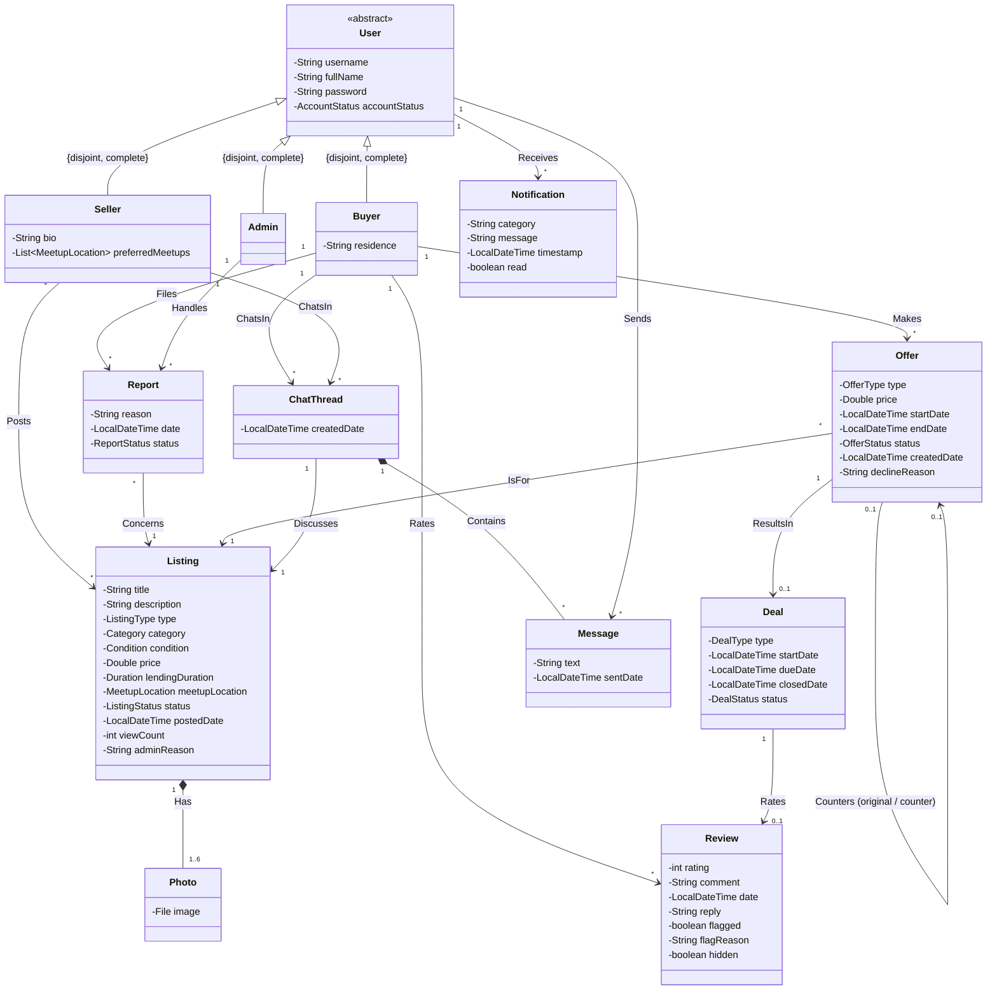
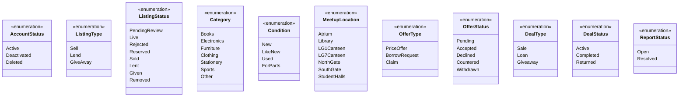

# HKUST Marketplace — UML Class Diagram & Domain Specification

This file contains the complete domain model and UML class diagram specifications extracted from `figures/class_diagram.pdf` and `main.tex`.

---

## 1. Domain Model Class Diagram

---

## 2. Enumerations

---

## 3. Class Specifications & Attributes

### 3.1 `User` (abstract)
* `username: String` — Unique identifier across all roles (cannot be empty, case-insensitive lookup).
* `fullName: String` — Display name.
* `password: String` — Hashed password (never store plaintext; rules: $\ge 8$ chars, uppercase, lowercase, digit).
* `accountStatus: AccountStatus` — `Active`, `Deactivated`, or `Deleted`.

#### Subclasses
* **`Buyer`**:
  * `residence: String` (optional, 0..1) — Hall preference or off-campus.
* **`Seller`**:
  * `bio: String` (optional, 0..1) — Brief seller profile description.
  * `preferredMeetups: List<MeetupLocation>` (0..*) — Selected campus meetup locations.
* **`Admin`**:
  * Seeded administrative account (e.g. `admin@ust.hk`).

---

### 3.2 `Listing`
* `title: String`
* `description: String`
* `type: ListingType` — `Sell`, `Lend`, `GiveAway`.
* `category: Category` — `Books`, `Electronics`, `Furniture`, `Clothing`, `Stationery`, `Sports`, `Other`.
* `condition: Condition` — `New`, `LikeNew`, `Used`, `ForParts`.
* `price: Double` (optional, 0..1) — Required only if `type == Sell`.
* `lendingDuration: Duration` (optional, 0..1) — Required only if `type == Lend` (min 5 seconds for tests).
* `meetupLocation: MeetupLocation` — Chosen campus meeting point.
* `status: ListingStatus` — Lifecycle: `PendingReview` $\rightarrow$ `Live` $\rightarrow$ `Reserved` $\rightarrow$ `Sold`/`Lent`/`Given` (or `Rejected`/`Removed`).
* `postedDate: LocalDateTime`
* `viewCount: int` — Incremented whenever listing detail is opened.
* `adminReason: String` (optional, 0..1) — Rejection or take-down reason from Admin.
* Associated with `Photo` (1..6).

---

### 3.3 `Photo`
* `image: File` (or file path `String`).
* Owned by `Listing` via composition (`Listing 1 *-- 1..6 Photo`).

---

### 3.4 `Offer`
* `type: OfferType` — `PriceOffer` (for Sell), `BorrowRequest` (for Lend), `Claim` (for GiveAway).
* `price: Double` (optional, 0..1) — Offered price.
* `startDate: LocalDateTime` (optional, 0..1) — Proposed borrow start date.
* `endDate: LocalDateTime` (optional, 0..1) — Proposed borrow end date.
* `status: OfferStatus` — `Pending`, `Accepted`, `Declined`, `Countered`, `Withdrawn`.
* `createdDate: LocalDateTime`
* `declineReason: String` (optional, 0..1) — Reason if declined by seller.
* **Self-association (`Counters`)**: An offer can counter an existing offer (`original` $\leftrightarrow$ `counter`).
* Linked to `1 Listing`, `1 Buyer`, and optionally results in `0..1 Deal`.

---

### 3.5 `Deal`
* `type: DealType` — `Sale`, `Loan`, `Giveaway`.
* `startDate: LocalDateTime`
* `dueDate: LocalDateTime` (optional, 0..1) — Due date for borrowed loans.
* `closedDate: LocalDateTime` (optional, 0..1) — Date marked complete or returned.
* `status: DealStatus` — `Active`, `Completed`, `Returned`.
* Associated with `1 Listing`, `1 Buyer`, `1 Seller`, `0..1 Offer`, and optionally `0..1 Review`.

---

### 3.6 `Review`
* `rating: int` (1 to 5).
* `comment: String`
* `date: LocalDateTime`
* `reply: String` (optional, 0..1) — Seller response (one reply allowed).
* `flagged: boolean` — Flagged by seller for admin review.
* `flagReason: String` (optional, 0..1) — Seller reason for flag.
* `hidden: boolean` — Hidden by admin (excluded from seller average rating).

---

### 3.7 `ChatThread` & `Message`
* **`ChatThread`**:
  * `createdDate: LocalDateTime`
  * Private thread between `1 Buyer` and `1 Seller` discussing `1 Listing`.
  * Contains `* Message` (composition).
* **`Message`**:
  * `text: String`
  * `sentDate: LocalDateTime`
  * Sender reference (`User`).
  * Permanent and searchable history.

---

### 3.8 `Notification`
* `category: String` — Categorized alerts (Offers, Chat, Borrow Reminders, Listings, Reviews, Announcements).
* `message: String`
* `timestamp: LocalDateTime`
* `read: boolean`
* Recipient: `User`.

---

### 3.9 `Report`
* `reason: String`
* `date: LocalDateTime`
* `status: ReportStatus` — `Open`, `Resolved`.
* Filed by `Buyer`, Concerns `1 Listing`, Handled by `Admin`.

---

## 4. Key Behavioral Rules & Constraints

1. **Atomic Concurrency**:
   * Claiming Giveaways: Only the first claimant succeeds; subsequent concurrent claims are rejected.
   * Offer Acceptance: Accepting an offer atomically updates listing to `Reserved` (or `Lent`), declines all other pending offers on the listing, and notifies those buyers.
   * Admin Take-down: Atomically declines pending offers and notifies buyers with active offers.
2. **Borrow Time Limits**:
   * Minimum borrow time: **5 seconds** (for automated testing / demo purposes).
   * Supports **Self-Return** before due date, and **Auto-Return** when due date expires (listing resets back to `Live`).
3. **Soft-Delete Policy**:
   * Users are marked `AccountStatus.Deleted` rather than hard deleted.
   * Listings are marked `ListingStatus.Removed`.
   * Deletion of user is prevented if they have `Active` deals.
4. **Rating Calculation**:
   * Average seller rating excludes any review where `hidden == true`.
