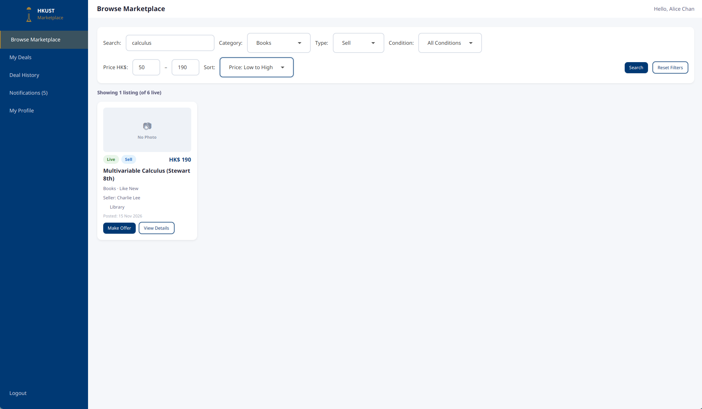
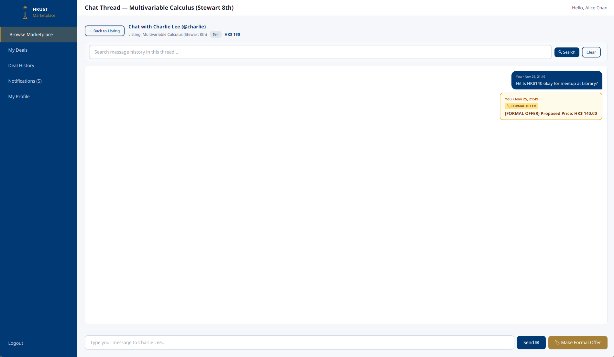
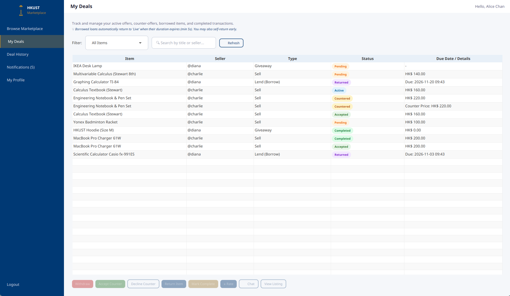
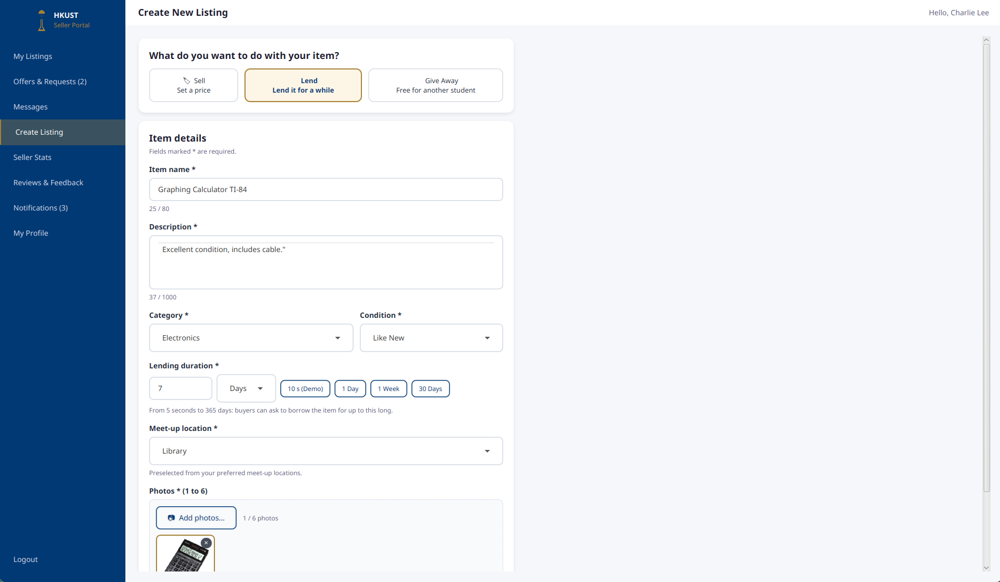
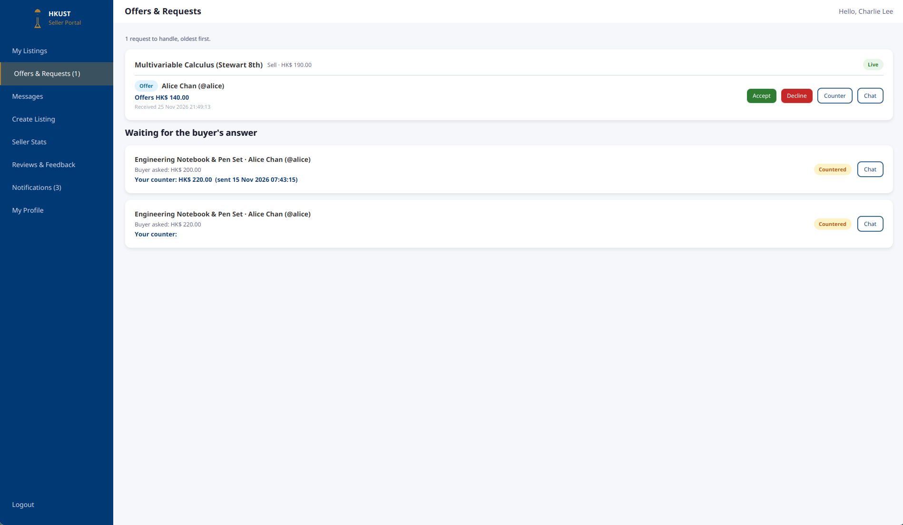
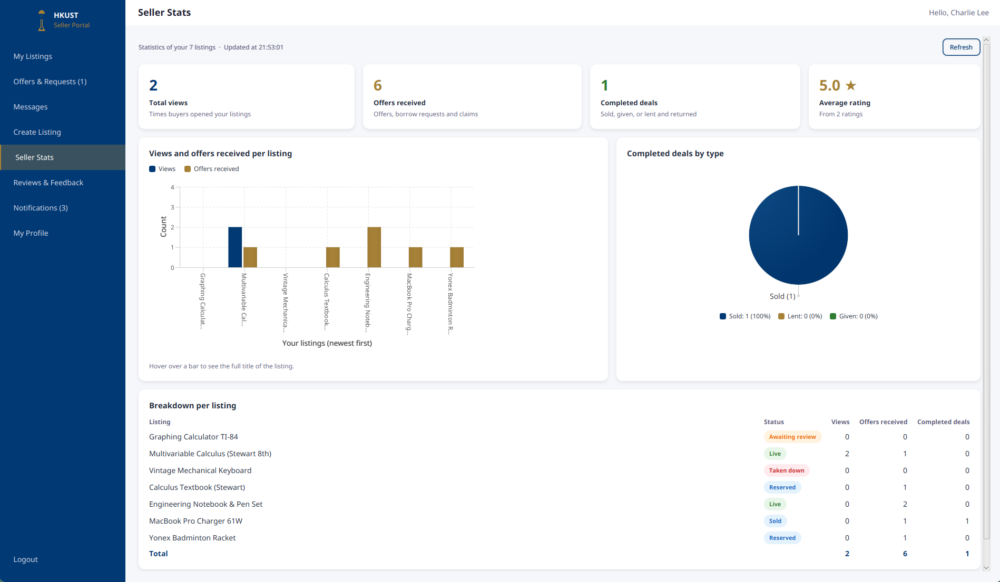
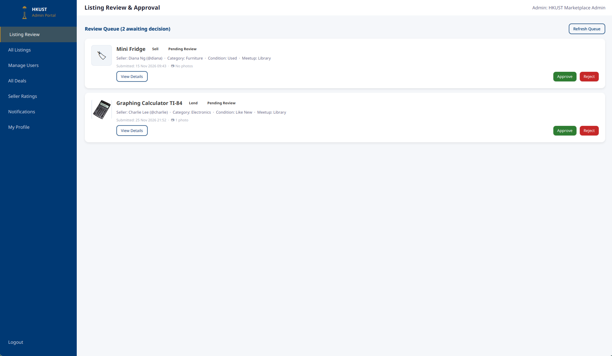
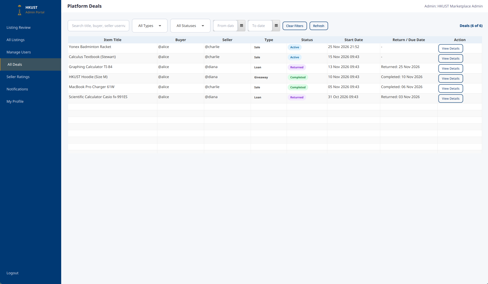

# 1. Application Execution Walkthrough & Sample Inputs/Outputs

[← Back to Submission Hub](README.md) · [Next: Unit Testing Report →](02_unit_testing_report.md)

The application provides a unified JavaFX 21 desktop interface styled with HKUST institutional branding (`#003974` navy blue and `#A68137` gold). Below are captured executions showing sample inputs and observed outputs across all three portals.

---

## 1.1 Buyer Portal (Task 1 — `US-B01` to `US-B11`)

### Scenario A: Login, Browse & Multi-Attribute Filtering (`US-B02`, `US-B03`)
- **Sample Inputs:**
  1. Log in on the Buyer Portal as `alice` / `password1`.
  2. In **Browse Marketplace**, set Search: `"calculus"`, Category: `"Books"`, Type: `"Sell"`, Price HK$: `50`–`190`, Sort: `"Price: Low to High"`.
- **Observed Outputs:**
  - Authenticates session (`"Hello, Alice Chan"`).
  - Filters live catalog to `"Showing 1 listing (of 6 live)"`: **Multivariable Calculus (Stewart 8th)** (`HK$ 190`, `Books · Like New`, Seller: `Charlie Lee`, `Library`).

---

### Scenario B: Private Chat Thread & Formal Price Offer (`US-B04`, `US-B05`, `US-B06`)
- **Sample Inputs:**
  1. Open **Multivariable Calculus (Stewart 8th)** and click **Chat with Seller**.
  2. Send free-text message `"Hi! Is HK$140 okay for meetup at Library?"`.
  3. Click **Make Formal Offer** and submit `140.00`.
- **Observed Outputs:**
  - Persists timestamped message in the private thread with Charlie Lee (`@charlie`).
  - Appends highlighted formal offer card (`[FORMAL OFFER] Proposed Price: HK$ 140.00`) and dispatches a seller notification.

---

### Scenario C: My Deals, Giveaway Claims, Loans & Completed Deals (`US-B05`, `US-B07`, `US-B11`)
- **Sample Inputs:**
  1. Claim **IKEA Desk Lamp** (`Giveaway`) from Browse, and open **My Deals**.
- **Observed Outputs:**
  - Displays all active offers, countered offers, accepted deals, returned loans, and completed deals in one unified table (`Pending`, `Active`, `Countered`, `Accepted`, `Returned`, `Completed`) with action controls (`Withdraw`, `Accept Counter`, `Decline Counter`, `Return Item`, `Mark Complete`, `Rate`, `Chat`, `View Listing`).

---

## 1.2 Seller Portal (Task 2 — `US-S01` to `US-S09`)

### Scenario D: Create Listing with Dynamic Lend Form & Photo Upload (`US-S03`)
- **Sample Inputs:**
  1. Log in on the Seller Portal as `charlie` / `password1` (`"Hello, Charlie Lee"`).
  2. Open **Create Listing**, select **Lend**, enter Item name: `"Graphing Calculator TI-84"`, Description: `"Excellent condition, includes cable."`, Category: `Electronics`, Condition: `Like New`, Lending duration: `7` `Days`, Meet-up location: `Library`, and attach `1` valid calculator photo.
- **Observed Outputs:**
  - Dynamically renders lending duration controls (with `10 s (Demo)`, `1 Day`, `1 Week`, `30 Days` presets).
  - Validates inputs and photo header, displays thumbnail preview (`1 / 6 photos`), copies the image into `data/uploads/listings/`, and submits the listing to `PENDING_REVIEW`.

---

### Scenario E: Offer & Request Management (`US-S05`)
- **Sample Inputs:**
  1. Open **Offers & Requests** on the Seller Portal.
- **Observed Outputs:**
  - Displays incoming offer from `Alice Chan (@alice)` (`Offers HK$ 140.00` on `Multivariable Calculus (Stewart 8th)`) with **Accept**, **Decline**, **Counter**, and **Chat** actions, alongside existing **Countered** offers awaiting buyer response.

---

### Scenario F: Seller Statistics & Interactive Charts (`US-S08`)
- **Sample Inputs:**
  1. Open **Seller Stats** on the Seller Portal.
- **Observed Outputs:**
  - Computes live summary metrics (`2 Total views`, `6 Offers received`, `1 Completed deals`, `5.0 ★ Average rating`), renders the **BarChart** (*Views and offers received per listing*) and **PieChart** (*Completed deals by type*), and shows the per-listing status breakdown (including `Graphing Calculator TI-84` as `Awaiting review`).

---

## 1.3 Administrator Portal (Task 3 — `US-A01` to `US-A08`)

### Scenario G: Listing Review & Approval Queue (`US-A01`, `US-A02`)
- **Sample Inputs:**
  1. Log in on the Admin Portal with `admin` / `admin123` (`"Admin: HKUST Marketplace Admin"`).
  2. Open **Listing Review**.
- **Observed Outputs:**
  - Lists all `PENDING_REVIEW` submissions (`Mini Fridge` by `@diana` and the newly submitted `Graphing Calculator TI-84` by `@charlie` with its uploaded photo thumbnail), providing **View Details**, **Approve**, and **Reject** actions.

---

### Scenario H: Platform Deals Oversight Ledger (`US-A05`)
- **Sample Inputs:**
  1. Open **All Deals** on the Admin Portal.
- **Observed Outputs:**
  - Displays all system-wide deals (`Deals (6 of 6)`) across `Sale`, `Loan`, and `Giveaway` transactions with search, type, status, and date-range filters plus **View Details** modal inspection.

